# Hi there 👋 It's me Jaswant Yuvarajan

### Developer | Problem Solver

- 🔭 Here's my [Portfolio](https://jaszportfolio.vercel.app/)                                                 
- 🌱 Currently learning DSA and exploring AI-powered development
- 💻 Building real-world projects and learning by doing
- ⚡ Fun fact: I know German!
- Social Presence
  
       

### 💻 I code in

  
  
  
  
  
  
  

### 🛠️ IDE and Tools I Use

  
  
  
  

### 💻 Workspace Spec

